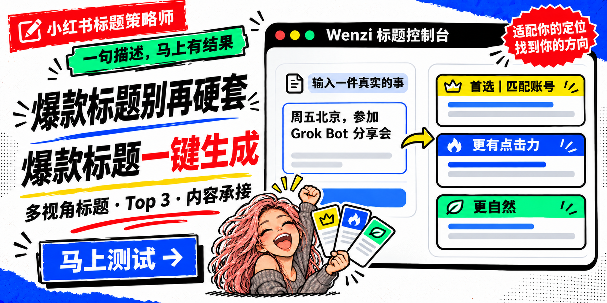

# 小红书标题策略师



> 一句描述，马上有结果。爆款标题别再硬套——适配你的定位，找到你的方向。

只需要说清楚一件真实发生的事，它会帮你：

- 从不同视角生成适配内容的标题
- 筛出首选、更有点击力、更自然的 Top 3
- 说明每个标题为什么值得选
- 给出正文承接和账号定位连接建议

## 先在线试一下

**[打开互动预览 →](https://wenziai.github.io/xhs-title-strategist/)**

你可以直接修改事件和账号定位，看看同一件事如何得到不同标题方向。

## 30 秒示例

输入：

> 我在后沙峪参加了一个用 AI 协助服饰搭配的线下沙龙。

输出包含首选标题、点击力标题、自然标题，以及正文应该如何承接。

## 安装

下载 [xhs-title-strategist.zip](xhs-title-strategist.zip)，解压到你的 Codex Skills 目录，开启新对话后直接描述一件事即可。

也可以直接复制本仓库中的 `SKILL.md`、`agents/` 和 `references/`。

## 使用方式

```text
帮我写小红书标题：周五我在北京参加了一场 Grok Bot 的 AI 分享会。
我的账号是北京生活记录，语气真实，不装专家。
```

如果你没有提供完整账号定位，它会先根据当前事件给出可用结果，不强迫你做一轮复杂访谈。

## 它不做什么

- 不机械套用所有“爆款公式”
- 不编造经历、数字或效果
- 不默认堆砌不断变化的热门标签
- 不为了蹭热点破坏账号长期定位

## Wenzi Skills

- [wenzi-xiaohongshu-workflow](https://github.com/wenziai/wenzi-xiaohongshu-workflow)
- [wenzi-xiaoyuzhou-workflow](https://github.com/wenziai/wenzi-xiaoyuzhou-workflow)
- **xhs-title-strategist：当前项目**

## GitHub Pages

仓库已经包含自动发布配置。上传到 `wenziai/xhs-title-strategist` 后，在仓库 **Settings → Pages** 中把 Source 设为 **GitHub Actions**，预览页将发布到：

`https://wenziai.github.io/xhs-title-strategist/`

